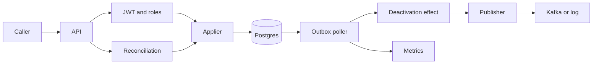
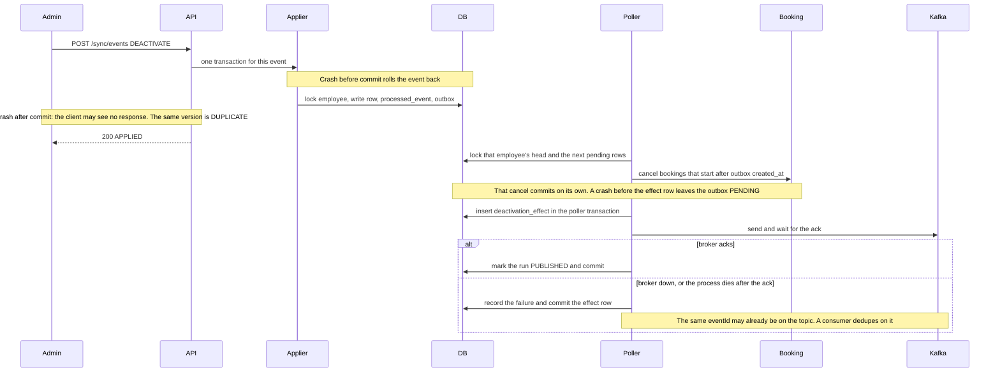
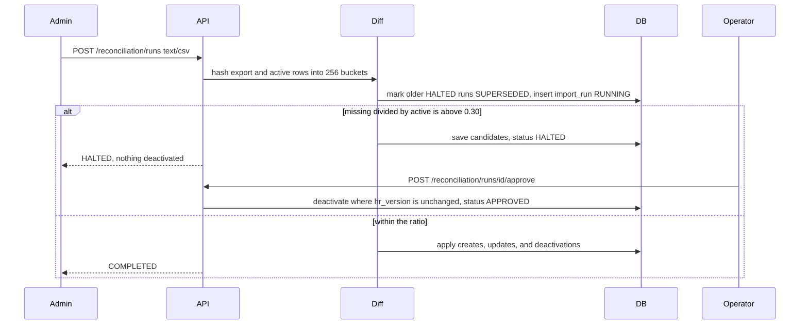

# Design

One process serves HTTP, applies roster changes, reconciles a nightly export, and publishes the outbox. Postgres is the source of truth. The outbox stays the source of truth for what must be delivered. `CompositeEventPublisher` runs two idempotent steps, in order, for each outbox row: the in-process deactivation effect, which dedupes on event id, then the configured publisher. `hr-sync.publisher` is `logging` or `kafka`. A failure at either step retries through the existing backoff, `FAILED`, replay, and discard path. Ingest does not talk to Kafka. A broker outage only grows the outbox backlog.

Within one employee's run the poller sends the next record only after the broker acknowledges the previous one, so a failure cannot let a later event overtake an earlier one. Different employees run in parallel on the publisher threads. That wait is the throughput trade-off: each event on an employee costs a round trip, and the other employees still publish at the same time.

The applier locks the employee row and commits that event, its `processed_event` row, and its outbox row in one transaction. A placeholder writes no outbox row. The poller locks each employee's oldest pending row (`FOR UPDATE SKIP LOCKED`) and the following pending rows of that employee, up to `employee-cap`, and publishes that run in id order. A failure stops the rest of that employee's run. Other employees continue. The booking cancel commits in its own transaction. The effect row is inserted in the poller transaction, then Kafka is asked to ack. `PUBLISHED` is written only after that ack, in the same transaction. A Kafka failure commits the effect row with the attempt and does not cancel bookings again on the retry. The message key is `tenantId:employeeId`. The value is ids, the event type, changed field names, the outbox id as `sequence`, `occurredAt`, and `schemaVersion`. The header is `correlationId`. There is no phone, email, name, or pickup point. Metrics are Micrometer gauges, counters, and timers, scraped at `GET /actuator/prometheus` by an operator.

## Deactivation

The cutoff is the outbox row's `created_at`, so a retry uses the same instant. A later create does not restore cancelled bookings. Any `FAILED` row blocks later rows for that employee until an operator replays or discards it. Other employees continue. The Kafka message carries `sourceVersion` from the outbox payload and `sequence` (the outbox id). The demo consumer drops a message whose `sourceVersion` is older than the highest version it has accepted for that key when its `sequence` is also older, and counts those as `stale`. A second copy of the same `eventId` is a duplicate, not a stale version.

## Reconciliation

A second run for a tenant that already has `RUNNING` gets 409. Starting a run marks every older `HALTED` run for that tenant `SUPERSEDED`. Approving a `SUPERSEDED` run returns 409 with code `SUPERSEDED` and deactivates nobody. The latest halted run can still be approved once. A halted run for another tenant stays `HALTED`. Startup marks every `RUNNING` row `FAILED` with reason `INTERRUPTED`. Each create, update, and deactivation commits on its own, so a crash keeps the ones that committed. Approval deactivates only when `hr_version` still equals the version saved with the halt, and it does not insert `processed_event`.

## Data model

`employee` is unique on `(tenant_id, employee_id)` and holds `hr_version`, `transport_version`, and status `ACTIVE`, `DEACTIVATED`, or `PLACEHOLDER`. The idempotency key is `(tenant_id, employee_id, channel, source_version)` on `processed_event`. HR and transport keep separate sequences. A matching key is `DUPLICATE`. A version that was never applied and is not newer than the channel version is `STALE_IGNORED`.

`outbox` is ordered by id per employee. Status is `PENDING`, `PUBLISHED`, `FAILED`, or `DISCARDED`. `deactivation_effect` is unique on the outbox event. `import_run` plus `import_run_deactivation` hold a reconciliation. Bookings live in schema `booking_svc`.

HR may write name, email, phone, manager, office, shift, `hr_version`, and status. Transport may write pickup point, special assistance, and `transport_version`.

## Failures

| What fails | Caller sees | Recovery |
| --- | --- | --- |
| Database down, the pool cannot connect, or a statement times out during ingest | 503, `Retry-After: 3`. The body is the per-record `results` plus `correlationId`. The record that hit the database is `RETRYABLE_ERROR` / `DATABASE_UNAVAILABLE`. Records not yet attempted are `RETRYABLE_ERROR` / `NOT_PROCESSED`. Records whose transactions already committed are `APPLIED`. A validation failure already decided stays `REJECTED` | Resend the batch after `Retry-After`. An applied record comes back `DUPLICATE`. Each change is stored once. A read that is not an ingest is still 503 `UNAVAILABLE` |
| App killed mid-ingest | Connection reset, or no body | The open transaction rolls back. A committed event stays, and the client may not have been told. The kill run recorded 290 more applies than the client saw |
| App killed mid-reconciliation | No final body | Restart marks the `RUNNING` row `FAILED` / `INTERRUPTED`. Committed applies stay. A new run can start |
| Booking client throws | The ingest already returned 200 | The outbox row stays `PENDING`, attempts increase, and that employee's later rows in the run are not published. After 5 attempts it is `FAILED` and blocks that employee. Replay or discard |
| Publisher throws | Same as a booking failure | Same retry. Other employees in the tick continue |
| Kafka down | Ingest still returns 200. The outbox row stays `PENDING` and its attempt count does not move. The publish circuit opens. `outbox_failed` stays 0 | Do not resend the batch. After backoff the poller probes one row, then drains that employee's rows in id order. A broker killed under load on 2026-10-31 left 69,035 pending and 0 failed, and the queue reached 0 in 20.855s |
| Broker restart | Ingest still returns 200. An in-flight ack can be lost or can land after the client gave up | The row stays `PENDING` until a later attempt observes an ack. A record that already landed is delivered again with the same `eventId` |
| Duplicate delivery | The consumer sees one `eventId` more than once | The broker acked and the process died before `PUBLISHED`, or a timed-out send landed and the retry sent it again. Dedupe on `eventId`. Order for one employee is the `sequence` |
| Duplicate or out-of-order event | 200, `DUPLICATE` or `STALE_IGNORED` | Nothing is written. A batch is applied in version order. The response stays in request order |
| Truncated export | 200, run `HALTED`, `MISSING_RATIO_EXCEEDED` | No deactivation until an operator approves. The threshold is 0.30. A repeated employee id, or a row for another tenant, is 400 and writes no employees |
| Approving a superseded halt | 409 `SUPERSEDED` | A later run for that tenant replaced this one. Approve the later halted run. Another tenant's halt stays `HALTED` |
| Two reconciliations at once | 409 `CONFLICT` | The partial unique index allows one `RUNNING` row per tenant |
| Expired, bad, or missing token | 401 `UNAUTHORIZED` | Sign in again. Tokens last 15 minutes. The wrong role is 403 |

## Choices

Consistency over availability. A change is not acknowledged until its transaction commits, and a later event for an employee waits while an earlier one is unpublished or `FAILED`. Availability is the 503: the caller retries, and idempotency makes the retry safe. Latency is spent on purpose. Each event is its own transaction, so a batch of 100 holds one pool connection for the whole request. The employee cache can be 10 seconds stale on another node, and an office can be 60 seconds stale. Login lockouts are in memory. Logging mode stays in this process. Kafka mode publishes after the effect and still commits the outbox here. A broker outage does not fail ingest. Reconciliation deactivation does not advance `hr_version` or write `processed_event`; the guard is the version captured at diff time.

A later version can move the deactivation effect to its own consumer of `hr-sync.employee-changes`. The outbox would only publish, and that consumer would dedupe on `eventId` the way the demo consumer does. This version keeps the effect in the poller, before the send, so a booking cancel does not wait on a second service.

## Cost

The applier does a fixed number of index lookups per event, then one commit. A batch is sorted first, so the sort is `n log n` for at most 1,000 events and the commits are linear. It stops scaling at the pool of 10. On the ramp, throughput flattened near 23 requests/s (about 2,300 events/s) after 8 virtual users, with p50 about 420 ms. After the poller started publishing on that same pool, the 60 second ingest at 8 virtual users was 15.87 requests/s (1,587 events/s, p50 487.1 ms), down from 19.07 requests/s (p50 418.7 ms) when the poller was stalled. App CPU rose from 102% to 391%.

The diff hashes both sides into 256 buckets. An identical 200,000-row export took 1.814 s and 2.217 s, and 400,000 rows took 4.620 s, with the heap staying on the bucket table (the lowest cap that passed was 48 MiB). A real diff stops on the apply path: a mix of about 5% took 36.217 s because each create, update, and deactivation is its own transaction.

The old poller could claim one row per employee. With eight employees, a limit of 100, and hash and merge joins turned off, the nested loop exceeded the 3 second statement timeout and published nothing. The new claim looks up heads in 1.81 ms on average, reads a run in 0.44 ms, and marks it with one `id = ANY` update in 0.30 ms. Claims in the ingest minute averaged 379 rows (max 401). The fastest tick was 4,046 rows/s. Pending age stayed under the gauge's one-second resolution, and the queue was `PUBLISHED` within half a second after load stopped. It stops scaling when the batch of 400, the cap of 100, two publisher threads, and the shared pool cannot keep up with ingest. That is the throughput trade-off of the faster poller: the queue drains, and ingest gives up about 3 requests/s to the connections the publisher holds.
